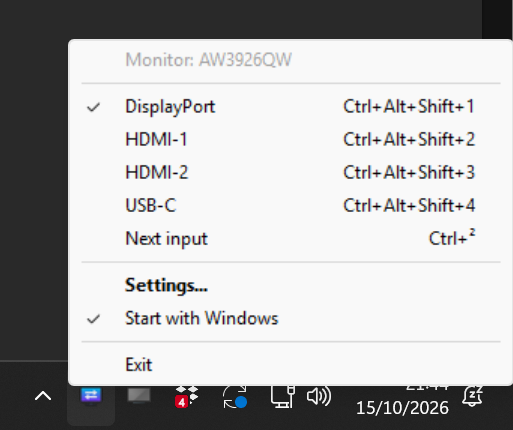
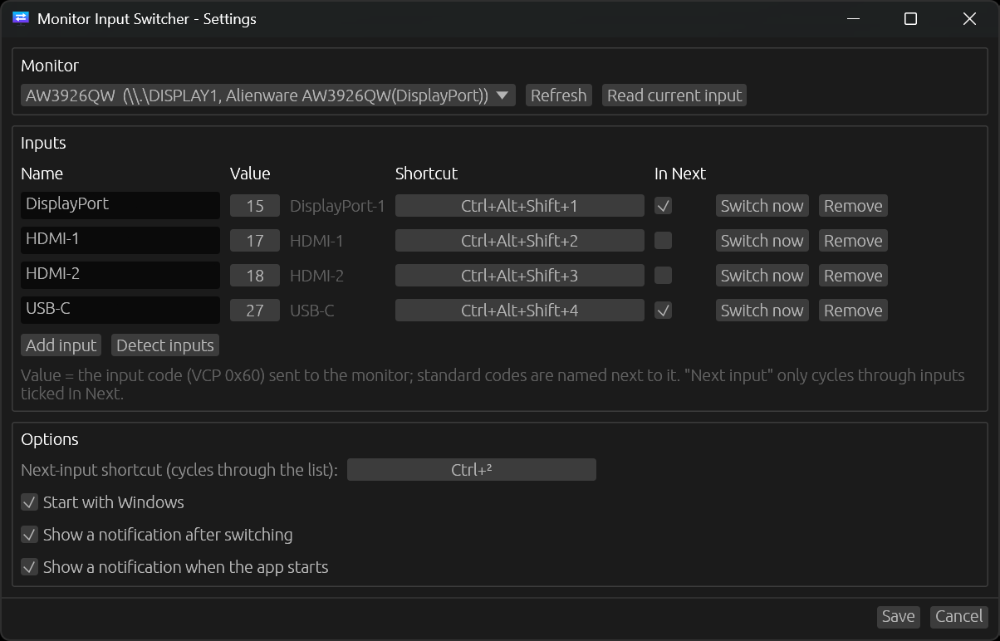

# Monitor Input Switcher

I have one monitor (an Alienware AW3926QW) shared by two computers: a desktop PC on DisplayPort and
a laptop on USB-C. Switching between them meant reaching behind the screen, opening the on-screen
menu, and clicking through it to Input Source every single time. After doing that one too many
times, I wrote this: a small tray app that switches the input with a keyboard shortcut instead.

I did look around first. Monitor makers' own control apps are very often heavy and only run on some
platforms (usually Windows only). Other open-source projects have tackled the same problem, but I
found them cumbersome for something I want to do with a single key press. So I went for a very
lightweight and efficient approach: one small binary with no runtime or external tools, which talks
to the monitor directly and switches in a fraction of a second.

It runs on Windows and Linux (KDE Plasma). I built and tested it on my own screen, but nothing in it
is specific to that model: it should work with any monitor that implements DDC/CI. On first run it
asks the monitor which inputs it has and sets itself up from that.

## Screenshots

The tray menu: the current input is checked, and each input shows its shortcut.



The Settings window: pick the monitor, name the inputs, set their shortcuts and choose which ones
"Next input" cycles through.



## How it works

The app writes VCP feature `0x60` (Input Source) over DDC/CI, the same channel the monitor's own
on-screen menu uses behind the scenes. On my monitor the built-in KVM moves the USB hub (keyboard
and mouse) along with the video input, so one shortcut moves both the screen and the keyboard to the
other computer. Since the monitor keeps listening on every port, either computer can switch to the
other one.

Everything lives in one Rust codebase. The config, automatic setup, "Next input", the Settings
window (egui) and the command line are shared; only the platform layer differs:

| | Linux (KDE Plasma) | Windows |
|---|---|---|
| DDC/CI | Raw I2C on `/dev/i2c-N` (no external tool) | Monitor Configuration API (`dxva2.dll`) |
| Global shortcuts | KDE `kglobalaccel` (works on Wayland) | `RegisterHotKey` |
| Tray and notifications | StatusNotifierItem + desktop notifications | `Shell_NotifyIcon` + balloons |
| Starts at login | `~/.config/autostart/` | `HKCU\...\Run` |
| Single instance, CLI transport | `flock` + Unix socket | named mutex + named pipe |
| Config | `~/.config/monitor-input-switcher/config.json` | `%APPDATA%\MonitorInputSwitcher\config.json` |

## What it does

- **Tray menu** (left- or right-click the icon): the monitor's name, one item per input (the
  current one is checked, with its shortcut next to it), Next input, Settings..., Start with login
  (Start with Windows on Windows), and Exit.
- **Global shortcuts**, changeable in Settings: `Ctrl+Alt+Shift+1`, `+2`, … for the inputs in order,
  and `Ctrl+Alt+Shift+S` for the next input. On KDE they also show up in
  System Settings > Keyboard > Shortcuts > Monitor Input Switcher, and both places stay in sync.
- **Automatic setup:** on first run (or whenever no input is configured) the app finds the connected
  monitor, reads the input codes it supports from its DDC/CI capabilities, and creates one input per
  code, named from the MCCS standard (DisplayPort, HDMI-1, USB-C, …). On mine that gives
  DisplayPort `15`, HDMI-1 `17`, HDMI-2 `18` and USB-C `27`. A notification lists what it created.
  "Detect inputs" in Settings adds missing ones later. If your monitor doesn't report its inputs,
  you can add them by hand.
- **Settings window:** monitor picker, editable inputs (name, VCP value, shortcut, "In Next", and a
  "Switch now" button to test), "Detect inputs", the next-input shortcut, start at login, and the
  startup and switch notifications.
- **"Next input"** only cycles through inputs ticked **In Next** (`IncludeInNext`, on by default), so
  you can skip the ports with nothing plugged in. Sadly, a monitor can't be asked which inputs
  actually have a signal: DDC/CI has no standard command for it.
- **Notifications:** one when the app starts, so you know it's running even when the tray icon is
  tucked away in the hidden icons (it can be turned off in Settings, except on the very first run).
  Also one after each switch (optional), and on errors (always).
- Only one instance runs, and it turns on start-at-login the first time it runs.

Before anything else, make sure DDC/CI is turned on in your monitor's on-screen menu. Most monitors
have it on by default, some hide it in a "System" or "Others" section.

## Download

Ready-made binaries for Linux (x86_64) and Windows (x86_64) are on the
[Releases page](https://github.com/a-elkaim/MonitorInputSwitcher/releases/latest). You can also build
it yourself, see below.

## Install on Linux (KDE Plasma)

Either download `monitor-input-switcher-<version>-linux-x86_64.tar.gz` from the
[latest release](https://github.com/a-elkaim/MonitorInputSwitcher/releases/latest) and extract it, or
clone this repository and build it (step 2). Run the commands below from the extracted folder or
the repository root.

### 1. One-time system setup (needs sudo)

```bash
sudo ./scripts/setup-system.sh
```

It does two things, and `sudo ./scripts/setup-system.sh --remove` undoes both:
- Loads the `i2c-dev` kernel module now and at boot (`/etc/modules-load.d/monitor-input-switcher.conf`),
  which provides `/dev/i2c-N`.
- Installs `/etc/udev/rules.d/60-monitor-input-switcher.rules`, which gives the logged-in user
  access to the I2C buses of graphics adapters (and only those):
  `SUBSYSTEM=="i2c-dev", ATTRS{class}=="0x03*", TAG+="uaccess"`. No group membership or new login
  is needed. This is the same rule `ddcutil` ships, so if `ddcutil` is installed it is already active.

> [!NOTE]
> **NVIDIA proprietary driver:** if the monitor shows up as *[DDC not working]*, create
> `/etc/modprobe.d/nvidia-ddc.conf` containing
> `options nvidia NVreg_RegistryDwords=RMUseSwI2c=0x01;RMI2cSpeed=100`, run
> `sudo update-initramfs -u`, and reboot. I didn't need this: on my ThinkPad the USB-C port is
> wired to the NVIDIA GPU, and DDC worked without changes.

### 2. Build (skip this with a release download)

You'll need a Rust toolchain ([rustup.rs](https://rustup.rs)). The build also needs `pkg-config`,
`libxkbcommon-dev`, `libwayland-dev` and `libegl-dev` (Debian/Ubuntu package names).

```bash
./scripts/build.sh              # builds target/release/monitor-input-switcher
./scripts/build.sh --debug      # debug build instead, in target/debug/
```

### 3. Install / uninstall

```bash
./scripts/install.sh            # installs the build to ~/.local/bin, adds the app launcher, lists displays, starts the app
./scripts/install.sh --debug    # same, with the debug build
./scripts/uninstall.sh          # removes it (keeps settings)
./scripts/uninstall.sh --purge  # also deletes ~/.config/monitor-input-switcher
```

To update, run `./scripts/install.sh` again from a newer release, or after `./scripts/build.sh`:
the install stops the running copy before replacing it.

Start at login is the file `~/.config/autostart/monitor-input-switcher.desktop`; the menu toggle
creates or deletes it.

## Install on Windows

The easiest way: download `monitor-input-switcher-<version>-windows-x86_64.exe` from the
[latest release](https://github.com/a-elkaim/MonitorInputSwitcher/releases/latest), put it wherever
you like and start it once. The exe isn't code-signed, so Windows SmartScreen may warn you the first
time: click "More info", then "Run anyway".

To build it yourself instead, you'll need [Rust](https://rustup.rs) with the default MSVC toolchain (rustup offers to install the
Visual Studio Build Tools if they're missing).

```bat
scripts\build.bat
```

Run it in cmd or PowerShell (it works from any folder). It builds
`target\release\monitor-input-switcher.exe`, a single file with no runtime to install, which you use
like the downloaded one. Add `--debug` for a debug build in `target\debug\` instead.

`build.rs` embeds the app icon (`assets/app.ico`) and version info using MSVC's resource compiler;
if the icon is missing, look for a "Could not embed the Windows icon" warning in the build output.

"Start with Windows" is the `MonitorInputSwitcher` value under
`HKCU\Software\Microsoft\Windows\CurrentVersion\Run`. It's updated to the exe's current path at each
start, so you can move the exe and just start it again.

## Command line

```bash
monitor-input-switcher                  # start the tray app (if it's already running, opens Settings)
monitor-input-switcher switch USB-C     # by name (case-insensitive) or by value: switch 27
monitor-input-switcher switch 0x11      # any input code, configured or not
monitor-input-switcher next
monitor-input-switcher get              # e.g. "6927 (0x1B0F) = DisplayPort"
monitor-input-switcher list             # e.g. "AW3926QW  (/dev/i2c-20, card2-DP-8)"
monitor-input-switcher capabilities     # model and input codes the monitor reports, plus the raw string
monitor-input-switcher settings
monitor-input-switcher quit
```

On Windows it's `monitor-input-switcher.exe`, from PowerShell or cmd. The commands go to the running
app (over `$XDG_RUNTIME_DIR/monitor-input-switcher.sock` on Linux, a named pipe on Windows), so DDC
operations never overlap. If the app isn't running, `switch`, `next`, `get` and `list` talk to the
monitor directly.

## Config

Both systems use the same JSON format:

```json
{
  "MonitorName": "AW3926QW",
  "MonitorDevice": null,
  "Inputs": [
    { "Name": "DisplayPort", "Value": 15, "Hotkey": "Ctrl+Alt+Shift+1", "IncludeInNext": true },
    { "Name": "HDMI-2", "Value": 18, "Hotkey": "Ctrl+Alt+Shift+2", "IncludeInNext": false },
    { "Name": "USB-C", "Value": 27, "Hotkey": "Ctrl+Alt+Shift+3", "IncludeInNext": true }
  ],
  "ToggleHotkey": "Ctrl+Alt+Shift+S",
  "ShowNotifications": true,
  "ShowStartupNotification": true
}
```

`MonitorName` is matched against the EDID model name. `MonitorDevice` optionally narrows the match:
`\\.\DISPLAY1` on Windows, `/dev/i2c-N` on Linux (a value from the other OS is ignored). With no
`MonitorName`, the only (or first) DDC/CI monitor is used. `Value` is the MCCS input code (VCP `0x60`).
The standard codes are `0x0F`/`0x10` DisplayPort-1/2, `0x11`/`0x12` HDMI-1/2, `0x03`/`0x04` DVI-1/2
and `0x01`/`0x02` VGA-1/2; `0x1B` is commonly USB-C. The Windows key is written `Win` on Windows and
`Meta` on Linux; both are accepted.

## Under the hood

### DDC/CI on Linux

On Linux the app skips `ddcutil` and talks to the monitor through the kernel's I2C interface
directly, so a switch takes about 30 ms.

| Piece | Implementation |
|---|---|
| DDC/CI | Raw I2C on `/dev/i2c-N`, monitor address `0x37` (VESA DDC/CI 1.1). Set input: write `51 84 03 60 <hi> <lo> <chk>`; that one write is the whole switch. Read: write `51 82 01 60 <chk>`, wait 40 ms, read the 11-byte reply and check its checksum. Commands are spaced 50 ms apart and retried up to 3 times. There's no verification after a set, since the monitor may stop answering this link once it has switched. |
| Detection | Every I2C bus of a graphics adapter (PCI class `0x03xxxx`, skipping disconnected DRM connectors) is probed in parallel: EDID at `0x50` gives the model, and a VCP `0x60` read tells whether DDC/CI answers. This runs once at startup (~1 s on my machine, due to empty buses timing out); the bus is cached and detected again after a failure. |
| Capabilities | Request `51 83 F3 <offset> <chk>`, read 32-byte fragments until an empty one (~1-3 s). The `vcp(...)` section lists the input codes, e.g. `60(1B 0F 11 12)`. Names come from the MCCS table (`0x0F` DisplayPort-1, `0x11` HDMI-1, …; `0x1B` USB-C is a common vendor extension). |
| Tray | StatusNotifierItem plus dbusmenu (`ksni`). |
| Shortcuts | KDE's `kglobalaccel` D-Bus service, the same mechanism KDE apps use. It works on Wayland and lists the shortcuts in System Settings. |
| Settings window | egui, run as a child process only while open, so the tray process stays small (about 10 MB). |
| Single instance | `flock` on `$XDG_RUNTIME_DIR/monitor-input-switcher.lock`. |
| Notifications | `org.freedesktop.Notifications`. |

### Keyboard layouts and Shift+digit shortcuts (KDE)

KWin drops Shift from a shortcut when Shift was needed to type a non-letter. As a result,
`Ctrl+Alt+Shift+1` arrives as `Ctrl+Alt+1` on AZERTY and as `Ctrl+Alt+!` on QWERTY. The app reads your
layouts from `~/.config/kxkbrc` and registers every variant, so the shortcut works on both `fr` and
`us`. One side effect on the `us` layout: `Ctrl+Alt+1` *without* Shift also triggers it. Digit-row
keys are recorded by position, as on Windows.

Punctuation keys, on both systems, are recorded as the character your layout puts on them: the key
left of `1` is saved as `²` on a French layout and as `` ` `` on a US one.

### Quirks I ran into

These come from my monitor; yours may behave differently, and the app tries not to depend on them.

- **Reading input `0x60` puts other data in the high byte.** For DisplayPort, Windows reads
  `0x0F0F` and the raw Linux read gives `0x1B0F`. Only the low byte is the input, so a reading
  matches an input when `reported == value || (reported & 0xFF) == value`.

## Troubleshooting

- **"No permission to open /dev/i2c-N"** or **"i2c-dev kernel module is not loaded"** (Linux): run
  `sudo ./scripts/setup-system.sh`.
- **Monitor shows "[DDC not working]" in Settings**: check that DDC/CI is on in the monitor's
  on-screen menu, and on Linux with the NVIDIA driver see the note in the Linux install section.
- **A shortcut does nothing**: another app may already use the key. On KDE, look for it in System
  Settings > Shortcuts; the app shows a notification when kglobalaccel refuses a shortcut. On
  Windows, a notification lists the shortcuts that couldn't be registered. Shortcuts are released
  while Settings is open, so it can record them.
- **Stuck modifier keys**: with the keyboard on the monitor's USB hub, switching unplugs it while
  Ctrl/Alt/Shift are still held. On Windows those keys stayed pressed, so on a shortcut press the
  app sends key-up events for any held modifier (`SendInput`), waits 30 ms, then switches. On Linux
  the kernel removes the keyboard's input device and libinput/KWin release every key held on it, so
  the app switches immediately. If modifiers ever do stick, please report it.
- **See the logs** (Linux): run it from a terminal with
  `monitor-input-switcher quit; monitor-input-switcher`.

## Development

```
cargo test                                        # unit tests
cargo check --target x86_64-pc-windows-msvc       # type-check the Windows build from Linux
```

To publish a release, bump `version` in `Cargo.toml`, commit, then push a matching tag:
`git tag v1.0.0 && git push origin v1.0.0`. The `Release` workflow (`.github/workflows/release.yml`)
builds and tests both systems and attaches the binaries to a new GitHub release. To check that both
builds pass before tagging, run it by hand with `gh workflow run release.yml` (or Actions > Release >
Run workflow): it builds and tests without publishing anything, and keeps the binaries as artifacts
of the run.

```
src/                  shared code: config, daemon, Settings window, CLI, capabilities parsing
src/platform/linux/   I2C DDC/CI, kglobalaccel + keyboard layouts, StatusNotifierItem tray, Unix socket
src/platform/windows/ dxva2 DDC/CI, RegisterHotKey, Shell_NotifyIcon tray, named pipe, Run key
assets/               icons (PNG for the tray and windows, ICO embedded in the Windows exe)
scripts/              build.sh / build.bat, plus the Linux install / uninstall / one-time system setup scripts
docs/screenshots/     the screenshots above
.github/workflows/    the release workflow
```

## License

Copyright (C) 2026 Allan ELKAIM

This project is licensed under the [GNU General Public License v3.0 or later](LICENSE). You're free
to use, modify and share it, as long as you keep the credit and copyright notices, and any version
you distribute (modified or not) comes with its source code under the same license.
